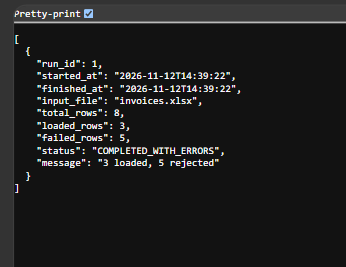
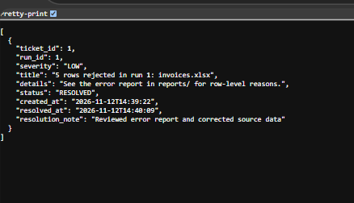

# Invoice Processing Bot (with monitoring API, ticketing and deployment scripts)

A Python automation bot that processes invoice Excel files the way an RPA bot would, plus the support
tooling around it: run monitoring, incident tickets, a REST API, runbook, CI and deployment scripts.
## Screenshots


## What it does
1. Reads an Excel file (`invoice_id, vendor, email, amount, invoice_date`).
2. Validates each row: required fields, email format, positive numeric amount, valid and non-future date,
   duplicate IDs (within the file and across earlier runs).
3. Loads valid rows into SQLite and writes rejected rows, with reasons, to an Excel error report.
4. Logs every step to `logs/bot.log` and records every execution in `bot_runs`
   (`SUCCESS`, `COMPLETED_WITH_ERRORS`, `FAILED`). A failed run is rolled back.
5. **Incident handling:** raises a support ticket (HIGH for a failed run, LOW for rejected rows) that can be
   resolved with a note.
6. **Monitoring REST API (FastAPI):** `/health`, `/runs`, `/runs/{id}`, `/tickets`, `/tickets/{id}/resolve`, `/invoices`.
7. **Windows and Linux:** `deploy/run.bat` and `deploy/run.sh` process the input folder and can be scheduled with
   Task Scheduler or cron. Paths and settings come from environment variables (`bot/config.py`).
8. **Deployment:** `deploy/deploy.sh` (venv, install, tests), a `Dockerfile`, and a GitHub Actions CI workflow.
9. **Documentation:** `docs/RUNBOOK.md` covers the daily check, status meanings, troubleshooting and ticket closure.

## Run it
```
pip install -r requirements.txt
python main.py sample                       # creates input/invoices.xlsx with good and bad rows
python main.py run input/invoices.xlsx
python main.py status
python main.py tickets --status OPEN
python main.py resolve 1 "Reviewed error report and corrected source data"
python main.py api                          # http://127.0.0.1:8000/docs
python -m pytest                            # 16 automated tests
```

## Layout
- `bot/validators.py` validation rules, `bot/db.py` tables and queries, `bot/runner.py` workflow and logging
- `bot/api.py` REST API, `bot/config.py` settings, `main.py` command line
- `deploy/` run and deploy scripts, `Dockerfile`, `.github/workflows/ci.yml`, `docs/RUNBOOK.md`
- `tests/` pytest tests for validation, the bot, tickets and the API

## Tech
Python, openpyxl, SQLite, FastAPI, pytest, Docker, GitHub Actions, Bash, Windows batch
